  

  
  
  
  
  
  
  
  

  <b>Viprasol Tech</b> is an independent engineering company based in Haryana, India. 
  We build custom trading bots, quant systems and software platforms, from your first rules to a system you can run.

<table align="center">
  <tr>
    <td align="center" width="170"><h3>1000+</h3>projects delivered</td>
    <td align="center" width="170"><h3>82+</h3>clients</td>
    <td align="center" width="170"><h3>15+</h3>countries</td>
    <td align="center" width="170"><h3><a href="https://www.upwork.com/freelancers/pravi">5.0★</a></h3>on Upwork</td>
  </tr>
</table>

## 01 / What we build

| Area | What you get | Built with |
|------|--------------|------------|
| **[Trading software and automation](https://viprasol.com/services/trading-software/)** | MT4/MT5 Expert Advisors, TradingView indicators and strategies, crypto and prediction-market bots, signals connected to your broker | MQL4, MQL5, Pine Script, Python, broker and exchange APIs |
| **[Quantitative engineering](https://viprasol.com/services/quant-development/)** | Research pipelines and backtests with realistic fees, slippage and drawdown, plus risk and position sizing | Python, vectorised backtesting, paper-trading engines |
| **AI agents and LLM tooling** | MCP servers, agent skills, regression tests and guardrails for agents that touch real systems | Python, TypeScript, MCP |
| **[B2B SaaS and platforms](https://viprasol.com/services/saas-development/)** | Account access, billing, reporting and integrations for the product your team or customers use every day | Next.js, React, Node.js, PostgreSQL, Stripe |

## 02 / Open source you can inspect

Our engineering lives on **[@Viprasol-Tech](https://github.com/Viprasol-Tech)**, with 140+ public repositories. A few places to start:

<table>
  <tr>
    <td width="50%" valign="top">
      <b><a href="https://github.com/Viprasol-Tech/kalshi-trading-bot">kalshi-trading-bot</a></b> &nbsp;Python 
      Algorithmic trading framework for Kalshi prediction markets: RSA-PSS auth, strategy engine, backtester and risk manager. Dry-run by default.
    </td>
    <td width="50%" valign="top">
      <b><a href="https://github.com/Viprasol-Tech/mt5-expert-advisor">mt5-expert-advisor</a></b> &nbsp;MQL5 
      MetaTrader 5 Expert Advisor: EMA crossover with risk-based lot sizing and ATR stops. The MT4 version is <a href="https://github.com/Viprasol-Tech/mt4-expert-advisor">mt4-expert-advisor</a>.
    </td>
  </tr>
  <tr>
    <td width="50%" valign="top">
      <b><a href="https://github.com/Viprasol-Tech/tradingview-indicators">tradingview-indicators</a></b> &nbsp;Pine Script v6 
      The source of 29 indicators we publish on TradingView, where they have 14,300+ boosts: Sniper Confluence, Elite Flow Pro, Liquidity Hunt Pro and more.
    </td>
    <td width="50%" valign="top">
      <b><a href="https://github.com/Viprasol-Tech/edgehunt">edgehunt</a></b> &nbsp;Python 
      Finds the edge in prediction markets: cross-venue arbitrage, fee-adjusted EV and Kelly sizing in one command, across Kalshi and Polymarket.
    </td>
  </tr>
  <tr>
    <td width="50%" valign="top">
      <b><a href="https://github.com/Viprasol-Tech/marketsmith">marketsmith</a></b> &nbsp;Python · MCP 
      MCP server that gives an AI agent prediction-market search, odds, fee-adjusted arbitrage, EV and Kelly sizing.
    </td>
    <td width="50%" valign="top">
      <b><a href="https://github.com/Viprasol-Tech/agentcheck">agentcheck</a></b> &nbsp;TypeScript 
      Regression testing for AI agents: snapshot tool calls, diff in CI and fail on regressions. Ships as a GitHub Action.
    </td>
  </tr>
</table>

Also worth a look: [awesome-trading-bots](https://github.com/Viprasol-Tech/awesome-trading-bots), our curated list of open-source trading bots, [pine-script-strategy](https://github.com/Viprasol-Tech/pine-script-strategy), a TradingView strategy template with a higher-timeframe trend filter and ATR stops, and [trading-strategy-review](https://github.com/Viprasol-Tech/trading-strategy-review), an agent skill that checks backtests for look-ahead bias, overfitting and risk of ruin.

On this account: [mt4-lot-size-calculator](https://github.com/Viprasol/mt4-lot-size-calculator), a free MT4 indicator for risk-based lot sizing.

**[Browse all repositories →](https://github.com/Viprasol-Tech?tab=repositories)**

## 03 / How we work

1. **Understand.** Your entry and exit rules, position sizing, broker and the decisions you still make by hand become a brief both sides can work from.
2. **Plan.** We map where data comes from, how orders are handled and what happens when a connection fails. You review scope and milestones before development starts.
3. **Build and review.** The software takes shape through working milestones you can try, so a misunderstanding never becomes a surprise at handover.
4. **Test against the brief.** Historical testing, demo execution, integration checks and failure scenarios, with a plain account of what was tested and what still needs watching live.
5. **Deploy and hand over.** Configuration, documentation and access, plus any monitoring or maintenance you want in place.

[See our approach →](https://viprasol.com/approach/) &nbsp;·&nbsp; [Case studies →](https://viprasol.com/case-studies/)

## 04 / Stack

  

  
  
  
  
  
  

## 05 / Start a conversation

Bring us the workflow you want to improve. You leave with a clear next step.

  
  

- Website: [viprasol.com](https://viprasol.com)
- Email: [support@viprasol.com](mailto:support@viprasol.com)
- Telegram: [t.me/viprasol_help](https://t.me/viprasol_help) · WhatsApp: [+91 96336 52112](https://wa.me/919633652112)
- Upwork: [upwork.com/freelancers/pravi](https://www.upwork.com/freelancers/pravi) · LinkedIn: [in/viprasol](https://www.linkedin.com/in/viprasol/)
- Open source: [@Viprasol-Tech](https://github.com/Viprasol-Tech) · TradingView: [@viprasol](https://www.tradingview.com/u/viprasol/)

---

  Trading involves risk. Historical results do not guarantee future performance. 
  © Viprasol Tech Private Limited

